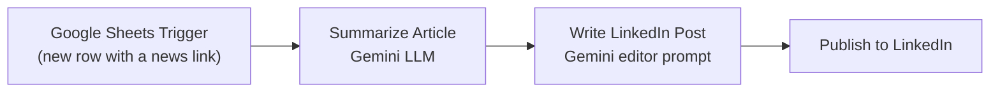

# News Link → LinkedIn Post Automation

An [n8n](https://n8n.io) workflow that turns news links from a Google Sheet into polished, publication-ready LinkedIn posts — automatically. Drop a link in a spreadsheet; within 30 minutes a professional post is drafted by AI and published to your LinkedIn profile.

## How it works

1. **Google Sheets Trigger** — polls your spreadsheet every 30 minutes for new rows
2. **Summarize Article** — a Gemini-powered LLM chain summarizes the article at the link
3. **Write LinkedIn Post** — a second Gemini chain rewrites the summary using a detailed content-editor prompt (concise, professional tone, factually faithful to the source)
4. **Publish to LinkedIn** — posts the result directly to your LinkedIn profile

## Why

Curating and writing LinkedIn content takes time. This workflow automates the routine part: you collect interesting articles in a sheet, and the pipeline handles summarization, editing, and publishing — so showing up consistently on LinkedIn costs a paste, not an hour.

## Setup

### Prerequisites

- A running [n8n](https://n8n.io) instance (self-hosted or n8n cloud)
- Accounts/credentials for:
  - **Google Sheets** (OAuth2) — to watch the source spreadsheet
  - **Google Gemini** — for both LLM chains (via the n8n AI gateway or a Google AI Studio API key)
  - **LinkedIn** (OAuth2) — with permission to create posts on your profile

### Steps

1. **Import the workflow**
   - In n8n: **Workflows → Import from File**
   - Select [`workflows/linkedin-post-automation.json`](workflows/linkedin-post-automation.json)
2. **Prepare the Google Sheet**
   - Create a spreadsheet with a column named `newslinks`
   - Paste article URLs into that column as new rows arrive
3. **Connect credentials**
   - Google Sheets Trigger → your Google Sheets OAuth2 credential
   - Both Gemini chat model nodes → your Google Gemini credential
   - Publish to LinkedIn → your LinkedIn OAuth2 credential
4. **Set the spreadsheet and profile**
   - Open the Google Sheets Trigger node and select your spreadsheet
   - Open the Publish to LinkedIn node and select your LinkedIn person URN
5. **Test** — run the workflow manually with one row in the sheet and check the generated post
6. **Activate** the workflow to let it poll every 30 minutes

## Required sheet format

| newslinks |
|---|
| https://example.com/article-1 |
| https://example.com/article-2 |

## Known limitations

- **No human review step** — posts go straight to LinkedIn. If you want a draft gate, replace the LinkedIn node with a Slack/email approval step, or write the draft back to the sheet for review.
- **No deduplication** — re-processed rows will generate new posts. Consider adding a "processed" status column.
- **Single LLM pass on the link text** — the workflow passes the URL to Gemini; for paywalled or JS-heavy pages, feed in the article text instead.

## What I'd add next

- An approval checkpoint before publishing
- Hashtag generation as an optional final step
- Posting to X/Medium from the same pipeline

## License

[MIT](LICENSE)
